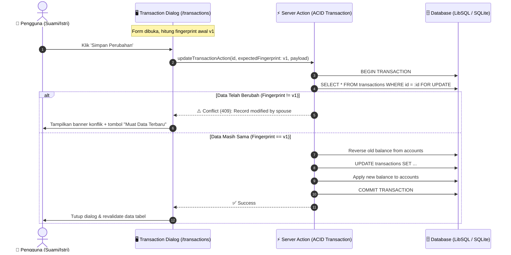

# Implementation Plan: Transaction CRUD with Anti-Collision Concurrency Control

Rencana implementasi teknis fitur **Tambah, Edit, dan Hapus Mutasi Transaksi (CRUD)** pada Muara Money Manager 2 dengan proteksi **Optimistic Concurrency Control (OCC)** untuk mencegah tabrakan data saat digunakan bersama oleh suami dan istri, input presisi waktu (**jam, menit, detik**), serta **isolasi analitik** untuk kategori `⚙️ Penyesuaian Saldo`.

---

## 1. Goal Description

Memberikan fleksibilitas penuh bagi pengguna untuk mencatat transaksi manual baru, mengoreksi mutasi yang salah, atau menghapus mutasi yang keliru langsung dari antarmuka web `/transactions`.
Secara khusus:
1. **Solusi Selisih Saldo**: Memungkinkan pencatatan mutasi penyesuaian saldo (misal tanggal 31 Agustus 2026 sebesar delta saldo riil bank vs catatan lama) di bawah kategori `⚙️ Penyesuaian Saldo`, tanpa mengotori/menggelembungkan analitik biaya hidup di `/monthly`.
2. **Kontrol Konkurensi Anti-Tabrakan (OCC)**: Mencegah hilangnya data (*Lost Update*) saat suami dan istri mengedit atau menghapus transaksi yang sama pada waktu bersamaan melalui verifikasi sidik data (*data fingerprint/hash*) dan transaksi database atomik (*ACID*).
3. **Presisi Kronologis**: Menyediakan input Tanggal (`YYYY-MM-DD`) dan Waktu (`HH:mm:ss` - Jam, Menit, Detik) agar posisi mutasi di tabel dan perhitungan saldo berjalan (*running balance*) akurat sesuai urutan riil.

---

## 2. User Review Required

> [!IMPORTANT]
> **Mekanisme Penanganan Benturan Konkurensi**:
> Jika Suami dan Istri membuka transaksi yang sama, lalu Suami menyimpan perubahan terlebih dahulu, maka saat Istri mencoba menyimpan, server akan menolak permintaan dengan status **Konflik (409)**. Form Istri tidak akan ter-reset; melainkan muncul banner peringatan interaktif:
> *"Transaksi ini baru saja diubah oleh pasangan Anda. Silakan klik 'Muat Data Terbaru' untuk meninjau perubahan terkini."*

> [!NOTE]
> **Isolasi Analitik `⚙️ Penyesuaian Saldo`**:
> Mutasi bertipe `EXPENSE` atau `INCOME` dengan kategori `⚙️ Penyesuaian Saldo` akan memperbarui saldo rekening (`accounts.currentBalance` dan saldo berjalan), namun **dikecualikan** dari perhitungan *Biaya Hidup Riil* (`totalExpenseCents`), *Pemasukan Murni* (`totalIncomeCents`), serta diagram kategori bulanan di `/monthly`.

---

## 3. Architecture & Data Flow

---

## 4. Proposed Changes

### A. Monthly Analytics Isolation
#### [MODIFY] `src/lib/data/monthly-analytics.ts`
- Tambahkan filter `AND (${categories.name} != '⚙️ Penyesuaian Saldo' OR ${categories.name} IS NULL)` pada query pemasukan operasional murni (`totalIncomeCents`), pengeluaran biaya hidup murni (`totalExpenseCents`), diagram rincian kategori (`getCategoryBreakdown`), dan timeline harian (`getDailyTimeline`).

### B. Concurrency Fingerprint Utility
#### [NEW] `src/lib/concurrency/transaction-fingerprint.ts`
- Fungsi `computeTransactionFingerprint(tx)`: Menghasilkan hash SHA-256 ringkas dari representasi string kanonikal transaksi:
  `accountId|targetAccountId|categoryId|subcategoryId|amount|type|date|time|description|note`
- Fungsi `verifyTransactionFingerprint(currentTx, expectedFingerprint)`: Memvalidasi kecocokan sebelum mutasi diperbolehkan.

### C. Concurrency-Safe Server Actions
#### [NEW] `src/actions/transaction-crud-actions.ts`
- Implementasi 3 Server Action berstandar ACID:
  1. `createTransactionAction(input)`
  2. `updateTransactionAction(id, expectedFingerprint, input)`
  3. `deleteTransactionAction(id, expectedFingerprint)`

### D. UI Components: Dialog & Action Column
#### [NEW] `src/components/transactions/transaction-form-dialog.tsx`
- Dialog responsif untuk **Tambah** dan **Edit** transaksi dengan dukungan tabs jenis transaksi, presisi tanggal & waktu (jam, menit, detik), format Rupiah, dan banner konflik OCC.
#### [NEW] `src/components/transactions/delete-transaction-dialog.tsx`
- Alert Dialog konfirmasi hapus dengan penjelasan pemulihan saldo akun terkait.
#### [MODIFY] `src/components/transactions/transactions-client.tsx`
- Tambahkan tombol `+ Tambah Transaksi` pada header `/transactions`.
- Tambahkan kolom `<TableHead className="w-20 text-center">Aksi</TableHead>` pada tabel.
- Hubungkan tombol Edit (pensil) dan Hapus (tempat sampah) pada setiap baris transaksi.
#### [MODIFY] `src/app/transactions/page.tsx`
- Ambil master kategori dan subkategori dari database untuk diteruskan ke `TransactionsClient`.

---

## 5. Bite-Sized Tasks & TDD Execution Steps

### Task 1: Isolation of `⚙️ Penyesuaian Saldo` in Monthly Analytics
- [ ] **Step 1 (RED)**: Buat unit test di `tests/unit/monthly-analytics-isolation.test.ts`.
- [ ] **Step 2 (GREEN)**: Modifikasi `src/lib/data/monthly-analytics.ts` untuk mengecualikan kategori `⚙️ Penyesuaian Saldo`.
- [ ] **Step 3**: Jalankan test dan verifikasi hijau.

### Task 2: Transaction Fingerprint & OCC Concurrency Control Utility
- [ ] **Step 1 (RED)**: Buat unit test di `tests/unit/transaction-fingerprint.test.ts`.
- [ ] **Step 2 (GREEN)**: Implementasikan `src/lib/concurrency/transaction-fingerprint.ts`.
- [ ] **Step 3**: Jalankan test dan verifikasi hijau.

### Task 3: Concurrency-Safe Server Actions for Transaction CRUD
- [ ] **Step 1 (RED)**: Buat unit test di `tests/unit/transaction-crud-actions.test.ts`.
- [ ] **Step 2 (GREEN)**: Implementasikan `src/actions/transaction-crud-actions.ts`.
- [ ] **Step 3**: Jalankan test dan verifikasi hijau.

### Task 4: Transaction Form Dialog & Delete Dialog
- [ ] **Step 1 (RED)**: Buat unit test di `tests/unit/transaction-form-dialog.test.tsx`.
- [ ] **Step 2 (GREEN)**: Implementasikan dialog form dan dialog konfirmasi hapus.
- [ ] **Step 3**: Jalankan test dan verifikasi hijau.

### Task 5: UI Integration on `/transactions`
- [ ] **Step 1 (RED)**: Buat unit test di `tests/unit/transactions-crud-ui.test.tsx`.
- [ ] **Step 2 (GREEN)**: Hubungkan dialog dan aksi ke `transactions-client.tsx` dan `page.tsx`.
- [ ] **Step 3**: Jalankan test dan verifikasi hijau.

### Task 6: Full Regression Verification & Type Check
- [ ] **Step 1**: Jalankan seluruh rangkaian tes tanpa regresi.
- [ ] **Step 2**: Jalankan `npx tsc --noEmit`.
- [ ] **Step 3**: Perbarui `walkthrough.md`.
